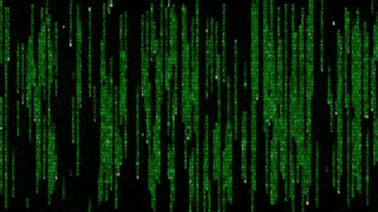

<!-- ======================================== -->
<!-- HIMESH AMBALIYA | OFFENSIVE SECURITY     -->
<!-- ======================================== -->

<h1 align="center">HIMESH AMBALIYA</h1>

<h3 align="center">
  Offensive Security Enthusiast | Ethical Hacking | Red Teaming
</h3>

<!-- MATRIX DIGITAL RAIN ANIMATION -->

<p align="center">
  
</p>

<!-- ANIMATED TYPING INTRO -->

<p align="center">
  
</p>

<p align="center">
  
  
  
</p>

---

## 👨‍💻 About Me

Hey! I'm **Himesh Ambaliya**, an M.Sc. Cyber Security student passionate about Offensive Security, Ethical Hacking, and Red Teaming.

I enjoy understanding how systems work, identifying security weaknesses, and exploring attack techniques in authorized environments.

- 🔭 Currently working on: Offensive Security Labs, CTF Challenges & Web Security Projects
- 👯 Looking to collaborate on: Ethical Hacking, Security Research & Open-Source Projects
- 🤝 Looking for help with: Advanced Exploit Development, Active Directory Security & Red Team Operations
- 🌱 Currently learning: Penetration Testing, Web Exploitation, Privilege Escalation & Binary Exploitation
- 💬 Ask me about: Kali Linux, Burp Suite, Nmap, Python, Web Security & CTFs
- ⚡ Fun fact: I love solving security challenges and thinking like an attacker.

### 🎯 Career Goal

To become a skilled **Offensive Security Engineer / Red Team Operator**, specializing in penetration testing, adversary simulation, vulnerability research, and exploit development.

---

## ⚔️ Technical Skills & Tools

### 🔴 Offensive Security

<p align="left">
  
  
  
  
  
</p>

### 💻 Programming Languages

<p align="left">
  
</p>

### 🛠️ Development & Platforms

<p align="left">
  
</p>

---

## 🧠 Areas of Interest

- 🌐 Web Application Penetration Testing
- 🌍 Network Penetration Testing
- 🔍 Vulnerability Assessment
- 🔓 Privilege Escalation
- 💥 Binary Exploitation & PWN
- 🔬 Reverse Engineering
- 🏢 Active Directory Security
- 🛡️ Red Team Operations
- 🔎 OSINT & Reconnaissance
- 🚩 Capture The Flag (CTF)

---

## 🚀 Featured Projects

| Project | Description |
|---|---|
| 🔐 JWT Security Research | JWT authentication security analysis and testing |
| 🌐 Web Application Pentesting | Authorized web security testing and OWASP labs |
| 💥 Binary Exploitation | PWN challenges, GDB and pwntools practice |
| 🛡️ Offensive Security Labs | Hands-on penetration testing laboratory |
| 🧪 Red Team Learning Journal | Documenting security concepts and lab exercises |

---

## 💻 My Security Environment

<p align="center">
  
  
  
  
</p>

### Terminal

```bash
┌──(himesh㉿kali)-[~]
└─$ whoami

Himesh Ambaliya

└─$ cat objectives.txt

[+] Offensive Security
[+] Web Application Penetration Testing
[+] Network Security
[+] Binary Exploitation
[+] Privilege Escalation
[+] Active Directory Security
[+] Red Team Operations

└─$ echo "Think Like an Attacker."
```

---

## 🌐 Connect With Me

<p align="center">

  <a href="https://www.linkedin.com/in/himesh-ambaliya-0a770628a/">
    
  </a>

  <a href="mailto:hello.himeshambaliya@gmail.com">
    
  </a>

  <a href="https://github.com/Himesh565">
    
  </a>

  <a href="https://www.instagram.com/alpha__security_/">
    
  </a>

</p>

---

<!-- ANIMATED FOOTER -->

<p align="center">
  
</p>

<h3 align="center">
  ⚡ Think Like an Attacker. Secure Like a Professional.
</h3>

<p align="center">
  <i>Learning. Hacking. Researching. Improving. 💚</i>
</p>
